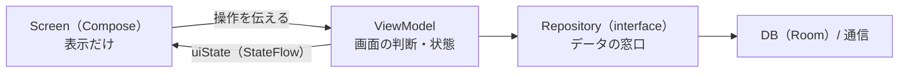

# Android アプリ

要件は [docs/apps/android.md](../../docs/apps/android.md)、設計は [docs/design.md](../../docs/design.md) を参照。

## 動かし方
1. Android Studio で `apps/android` フォルダを開く（初回は「Sync Now」を押す）
2. 実行先を選ぶ（エミュレーター、または USB デバッグを有効にした実機）
   - エミュレーター: Device Manager（右端のスマホのアイコン）で、端末の ▶ を押して起動する
3. 上のツールバーの ▶（Run 'app'）を押す

コマンドで確かめるとき（ビルドとユニットテスト）:
```sh
cd apps/android
JAVA_HOME="/Applications/Android Studio.app/Contents/jbr/Contents/Home" ./gradlew assembleDebug testDebugUnitTest
```

## パッケージ構成
`com.p2pchat.app` の下を、**層で分ける**。`ui/` の中だけは機能（画面）ごとに分ける。

```text
com.p2pchat.app/
├── P2PChatApp.kt      # Application。AppContainer を 1 つ持つ
├── MainActivity.kt    # 画面の入口。AppNavGraph を表示するだけ
├── di/
│   └── AppContainer.kt    # 部品（DB・Repository）をここで作って持つ（手動 DI）
├── data/              # データの取得・保存
│   ├── contact/       #   Contact、ContactRepository（interface）、その実装
│   └── db/            #   Room（AppDatabase、Entity、Dao）
└── ui/                # 画面
    ├── navigation/    #   Routes.kt（行き先）、AppNavGraph.kt（画面のつながり）
    ├── contacts/      #   連絡先一覧。MVVM の見本
    ├── chat/ qr/ settings/   # 仮画面。各 Issue で本実装にする
    ├── common/        #   画面をまたいで使う部品
    └── theme/
```

## データの流れ（MVVM）


| 部品 | 役割 | 見本 |
|---|---|---|
| Screen | `uiState` を表示し、操作を ViewModel やナビゲーションに伝える。判断はしない | `ContactsScreen` |
| ViewModel | 画面の状態（`UiState`）を持ち、操作に応じて更新する。Android の画面部品を触らない | `ContactsViewModel` |
| Repository | データの取得元を隠す。ViewModel は interface だけを知る | `ContactRepository` |
| AppContainer | 部品を 1 か所で作って持つ。ViewModel は Factory で取り出す | `AppContainer` |

## 画面を 1 つ追加する手順
`ui/contacts/` を見本にする。ここでは「foo 画面」を足すとする。

1. `ui/foo/` を作る
2. **UiState** を作る（`FooUiState`）。画面の見た目を決める値を、data class にまとめる
3. **ViewModel** を作る（`FooViewModel`）。必要な部品はコンストラクターで受け取り、`uiState` を `StateFlow` で公開する。`companion object { val Factory }` も `ContactsViewModel` と同じ形で書く
4. **Screen** を作る（`FooScreen`）。`viewModel(factory = FooViewModel.Factory)` で ViewModel を取り、表示は `FooContent(uiState, ...)` に分ける（プレビューしやすくなる）
5. `ui/navigation/Routes.kt` に行き先を足す（引数がなければ `@Serializable data object Foo`）
6. `ui/navigation/AppNavGraph.kt` に `composable<Foo> { FooScreen(...) }` を足し、移動元から `navController.navigate(Foo)` で呼ぶ
7. 表示する文字は `res/values/strings.xml` に書く
8. ViewModel のテストを `src/test/` に書く（`ContactsViewModelTest` を見本にする）

## データの取得元（Repository）を追加する手順
1. `data/<名前>/` に interface を作る（ViewModel が使うのはこれだけ）
2. 実装を作る（Room や通信を使う）
3. `di/AppContainer.kt` にプロパティを足して組み立てる
4. ViewModel の Factory で、`app.container.<名前>` を取り出して渡す

## テストの書き方
- ViewModel のテストでは、Repository を**テスト用の偽物（Fake）に差し替える**。`ContactsViewModelTest` が見本
- `MainDispatcherRule` を `@get:Rule` に書くと、ViewModel の非同期処理をテストで扱える
- 実行: `./gradlew testDebugUnitTest`

## 補足
- **minSdk は 31**（Android 12 以上）
- **Room**: `AppDatabase` の `exportSchema = false`（開発中はスキーマを書き出さない）。テーブルを足すときは `entities` に加えて `version` を上げる。DB の設計は #19 で進める
- **Navigation**: 行き先は型で表す（文字列ではない）。引数が要る画面は `data class` にする
- **用語**: `Flow` / `StateFlow` / `viewModelScope` は、見本のコードに出てくる。分からなくても、見本と同じ形で書けば動く。理解は後からで構わない
