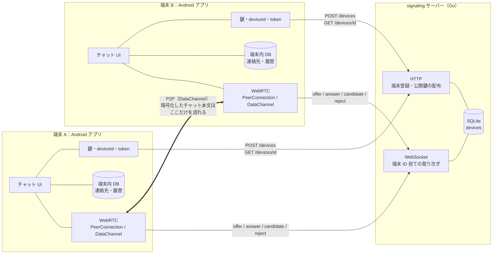
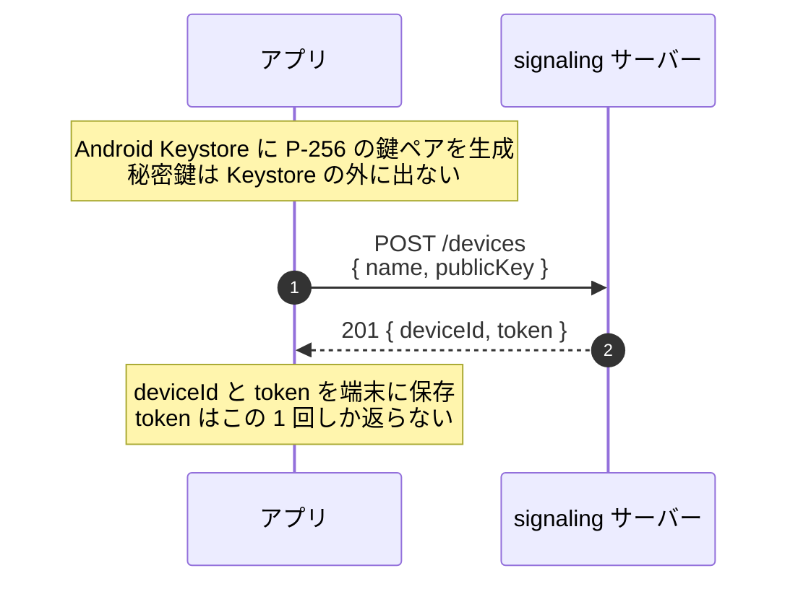
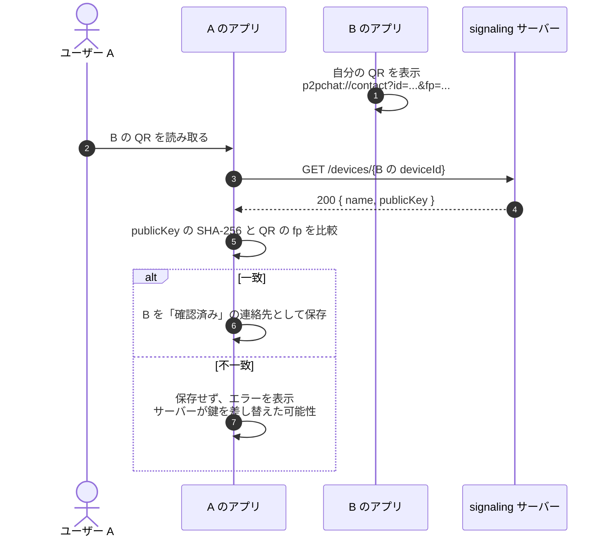
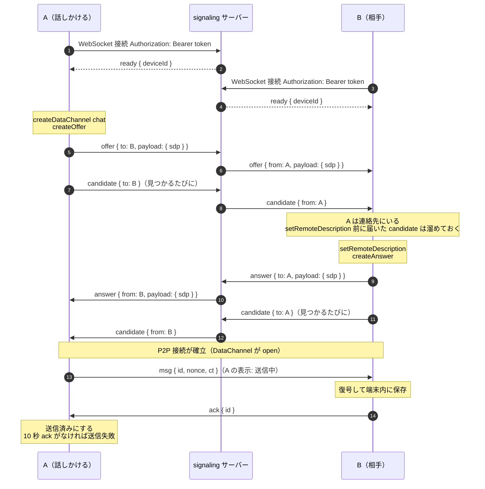
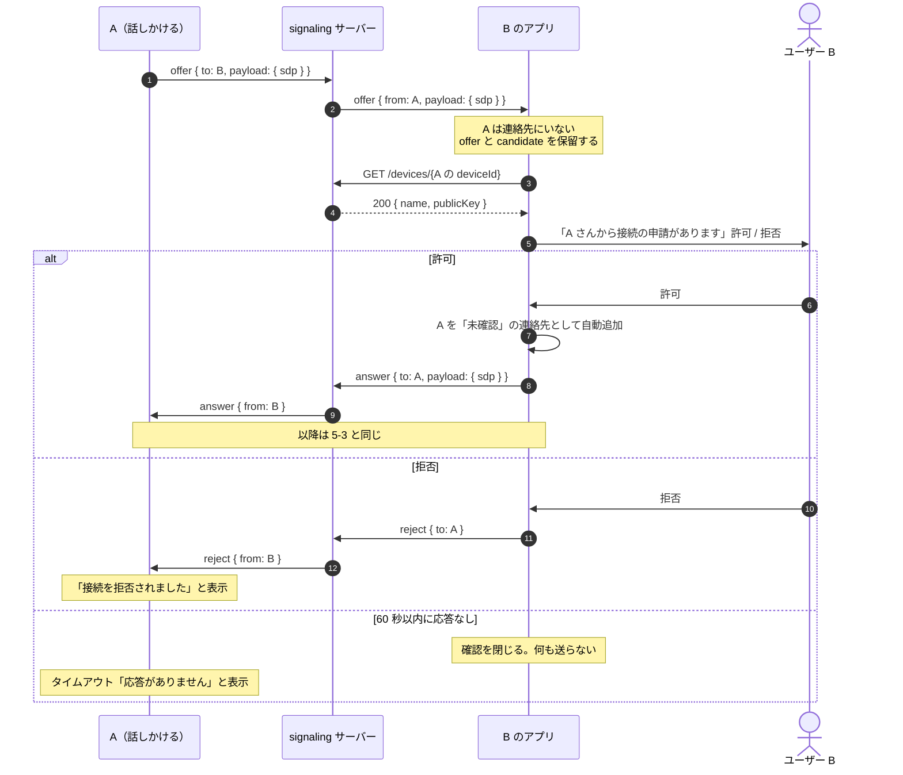
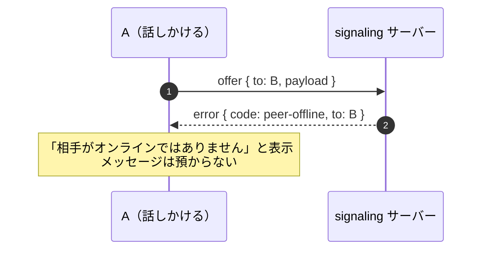
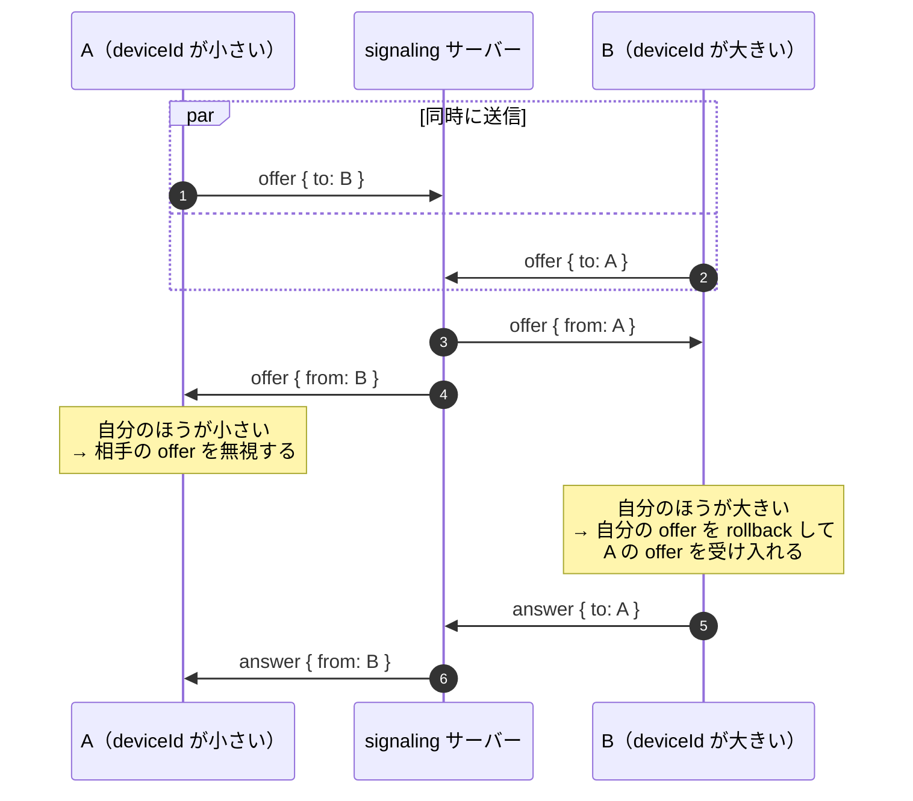
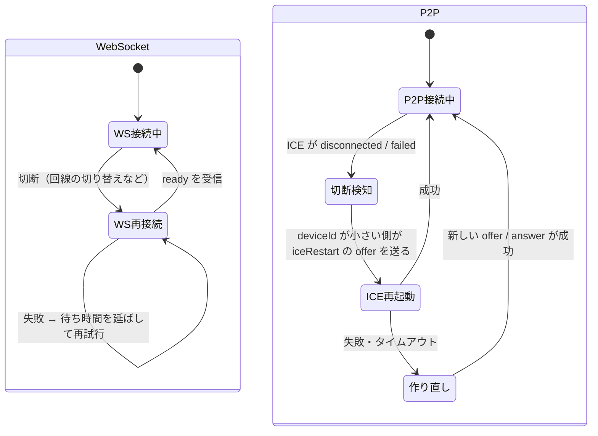
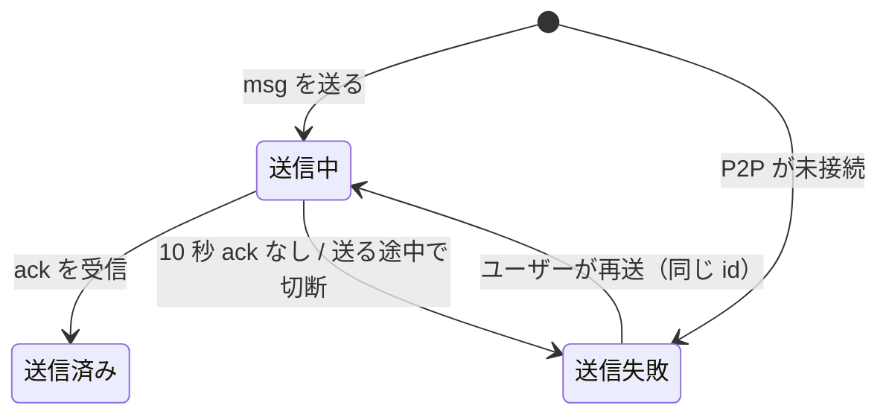
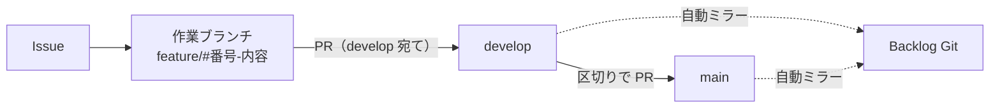

# P2P チャット MVP 設計

| 項目 | 内容 |
|---|---|
| バージョン | **v0.2** |
| 更新日 | 2026-10-14 |
| 状態 | サーバー（signaling）は実装済み。Android / iOS はプロジェクトの雛形のみ |
| 対象 | Android アプリ 1 種類 + シグナリングサーバー |

### 変更履歴
| 版 | 内容 |
|---|---|
| v0.2 | 鍵を P-256 + Android Keystore に変更、minSdk 31、アプリの構成方針、開発の進め方（ブランチ・レビュー・CI・Backlog 同期）を追加 |
| v0.1 | 初版 |

## 1. 概要

### 目的
スマートフォン同士が、サーバーを経由せずに直接（P2P）チャットできるアプリを作る。サーバーは「誰と誰をつなぐか」の仲介だけを行い、チャットの内容を見ない・保存しない。

### MVP のゴール
```text
QR で相手を登録する → 相手を選ぶとサーバーが仲介してつなぐ → 暗号化したメッセージを P2P でやりとりする（履歴は端末に残る）
```

### 用語

| 用語 | 意味 | 担当 |
|---|---|---|
| **取り次ぎ**（仲介） | 接続の準備に使う情報（offer、answer、ICE candidate、reject）を、宛先の端末へ渡すこと | signaling サーバー |
| **データ中継** | P2P で直接つながれないときに、チャット本文そのものを経由させること | TURN サーバー（MVP では使わない） |
| **接続の申請** | 連絡先にいない相手から offer が届くこと。受けた側が許可するまで P2P はつながらない | アプリ |

### 前提
- 利用範囲は、同じネットワーク（同じ Wi-Fi、またはテザリング）にいる端末同士。学内でのローカル利用を想定している。
- サーバーは開発用 PC で起動し、スマホのアプリから PC の IP アドレスを指定して接続する。

---

## 2. スコープ

| 区分 | 内容 |
|---|---|
| **MVP に含む** | 端末の登録（公開鍵の預け入れ）、QR による相手の登録、知らない相手からの接続の申請（許可・拒否）、サーバー仲介の P2P 接続、1 対 1 のテキストチャット（暗号化）、送信状態の表示（送信中・送信済み・送信失敗）、端末内の履歴保存、WebSocket と P2P の再接続 |
| **MVP に含まない** | iOS アプリ、TURN（直接つながらない回線でのデータ中継）、相手がオフラインのときのメッセージ預かり、プッシュ通知、連絡先の削除、ブロック、既読表示、グループチャット、画像・ファイル送信、端末の再登録（機種変更・紛失） |

---

## 3. アーキテクチャ

### 3-1. 構成図



### 3-2. コンポーネントと責務

| コンポーネント | 責務 | 持たないもの |
|---|---|---|
| **Android アプリ** | 鍵の生成と保管、端末登録、QR の表示と読み取り、接続の申請の確認、連絡先と履歴の保存、メッセージの暗号化と復号、WebRTC による P2P 通信、再接続 | |
| **signaling サーバー** | 端末の登録と公開鍵の配布、トークン認証、端末 ID を宛先にした offer / answer / candidate / reject の取り次ぎ、オフライン宛先の通知（`peer-offline`） | 秘密鍵、連絡先、チャット本文、履歴 |
| **SQLite**（サーバー内） | `devices` テーブル（端末 ID、名前、公開鍵、トークンのハッシュ、作成日時） | |
| **STUN / TURN** | MVP では使わない。同じネットワークなら不要 | |

サーバーの詳細は [services/signaling.md](services/signaling.md)、アプリの要件は [apps/android.md](apps/android.md) を参照。

### 3-3. 技術スタック

| 領域 | 採用 | 備考 |
|---|---|---|
| サーバー | Go、SQLite（`modernc.org/sqlite`）、WebSocket（`coder/websocket`） | C コンパイラ不要。Mac / Windows で `go run` するだけで動く |
| アプリ | Kotlin、Jetpack Compose、ネイティブ WebRTC | minSdk 31（Android 12）。MVVM + Repository、手動 DI、Room、Navigation Compose |
| 通信 | WebRTC DataChannel（P2P）、シグナリングは WebSocket | |
| 暗号 | ECDH（P-256、Android Keystore）+ HKDF-SHA256 + AES-256-GCM | OS 標準の機能で実装する。詳細は「7. アプリ共通のルール」 |
| 開発環境 | サーバーは PC で直接起動、アプリは Android Studio | Docker はデプロイ時に検討する |
| CI・リポジトリ | GitHub Actions、GitHub（正）→ Backlog Git（自動ミラー） | 詳細は「9. 開発の進め方」 |

### 3-4. データの置き場所

| データ | サーバー | 端末 |
|---|---|---|
| 端末 ID（`deviceId`） | ○ | ○ |
| 公開鍵 | ○ | ○（自分の鍵と、連絡先の鍵） |
| 秘密鍵 | ✕ | ○（Android Keystore の中。アプリからも取り出せない） |
| 認証トークン | ハッシュのみ | ○（平文） |
| 連絡先（確認済み / 未確認） | ✕ | ○ |
| チャット本文・履歴 | ✕ | ○ |

### 3-5. 設計方針

1. **1 端末 = 1 ユーザー。** `deviceId` がそのままユーザー ID。アカウントやログインの仕組みは持たない。
2. **友達機能はない。** QR を読んだ端末が、相手の情報を端末内に保存する。**片方が QR を読めば、話しかけられる。**
3. **知らない相手からの接続は許可制。** 連絡先にいない相手から offer が届いたら、ユーザーに確認する。許可すれば相手を連絡先に自動追加して P2P をつなぎ、拒否すれば `reject` を返す。許可するまで、受けた側は自分の IP アドレス（ICE candidate）を出さない。
4. **メッセージは端末間で暗号化する。** 自分の秘密鍵と相手の公開鍵から共通の鍵を作り、本文を暗号化する。P2P 経路の DTLS に加えた二重の保護で、サーバーが接続に割り込んでも本文は読めない。
5. **サーバーはチャットの内容を見ない。** 本文は P2P だけを流れる。サーバーが取り次ぐのは、接続の準備に使う情報だけ。
6. **履歴は端末が持つ。** サーバーに履歴を残さないので、端末を失くすと履歴も失われる。

### 3-6. セキュリティの考え方

| 脅威 | 対策 | MVP |
|---|---|---|
| 通信の盗聴 | P2P 経路は DTLS で暗号化。さらに本文を端末間で暗号化（AES-256-GCM） | ○ |
| サーバーが接続に割り込む（中間者攻撃） | 本文は相手の公開鍵から作った鍵で暗号化しているため、割り込まれても読めない・改ざんできない | ○（確認済みの相手） |
| サーバーが公開鍵をすり替える | QR に公開鍵のハッシュ（`fp`）を入れ、読み取った側が照合する。申請から自動追加した相手は「未確認」と表示し、QR を読むと「確認済み」になる | △（未確認の相手は防げない） |
| 知らない人からの接続・迷惑な連絡 | 接続の申請を確認し、拒否できる | ○ |
| IP アドレスの露出 | 受けた側は、許可するまで ICE candidate を出さない。話しかけた側の IP は相手に届く（学内 LAN ではプライベート IP のみ） | △ |
| 送信状態の偽装 | 受信確認（`ack`）は暗号化していないため、割り込んだ者が「送信済み」を偽装できる（本文は守られる） | ✕ |
| 登録の乱用 | 端末登録の制限が必要 | ✕（ローカル開発のみ） |

- サーバーから見えるのは、端末 ID、公開鍵、誰が誰に接続しようとしたか、その時刻まで。
- 秘密鍵は Android Keystore の中で作り、外に出さない設定にする。鍵共有の計算も Keystore の中で行う。
- 鍵は固定（端末ごとに 1 つ）なので、前方秘匿性はない。万一秘密鍵が漏れると、記録されていた過去の暗号文も読める。

---

## 4. リポジトリ構成

```text
.
├── apps/
│   ├── android/              # Android アプリ（Kotlin）
│   └── ios/                  # iOS アプリ（Swift、MVP 対象外。雛形のみ）
├── services/
│   └── signaling/            # シグナリングサーバー（Go）
├── .github/workflows/        # CI、Backlog へのミラー
└── docs/
    ├── design.md             # この文書
    ├── apps/
    │   └── android.md        # Android アプリの要件
    └── services/
        └── signaling.md      # サーバーの概要・責務・ファイル構造
```

---

## 5. 通信フロー

話しかける側を A、受ける側を B とする。

### 5-1. 初回起動：端末の登録



### 5-2. QR で相手を登録

片方が読めば十分。読んだ側が、相手を「確認済み」の連絡先として保存する。



### 5-3. 連絡先にいる相手との P2P 接続

A が話しかける。B の連絡先に A がいる場合は、確認なしでつながる。



### 5-4. 知らない相手からの接続の申請

B の連絡先に A がいない場合。B のユーザーが許可するまで、B は PeerConnection を作らず、candidate も出さない。



### 5-5. 相手がオンラインでないとき



### 5-6. 同時に offer を送り合ったとき

`deviceId` の辞書順が**小さいほう**の offer を採用する。



### 5-7. 接続が切れたとき

WebSocket と P2P は別々に切れる。それぞれ独立して立て直す。



- ICE 再起動と作り直しには、offer / answer をやりとりするため、WebSocket が `ready` の状態である必要がある。
- 同じ端末が WebSocket に再接続すると、サーバーは古い接続を切断する。
- アプリが背面に回ると接続は切れる。チャットは前面で開いている間だけ動く（MVP）。

---

## 6. API 仕様

### 6-1. API 一覧

#### HTTP

| メソッド | パス | 認証 | 用途 | 使う場面 |
|---|---|---|---|---|
| `GET` | `/healthz` | 不要 | 死活確認 | 接続できるかの確認 |
| `POST` | `/devices` | 不要 | 端末を登録し、公開鍵を預ける | 初回起動 |
| `GET` | `/devices/{id}` | 不要 | 名前と公開鍵を取得する | QR を読んだとき、接続の申請を受けたとき |

#### WebSocket（`/ws`、`Authorization: Bearer <token>` が必要）

| 向き | type | 主なフィールド | 用途 |
|---|---|---|---|
| クライアント → サーバー | `offer` | `to`, `payload` | 相手に SDP offer を送る |
| クライアント → サーバー | `answer` | `to`, `payload` | 相手に SDP answer を送る |
| クライアント → サーバー | `candidate` | `to`, `payload` | 相手に ICE candidate を送る |
| クライアント → サーバー | `reject` | `to` | 接続の申請を拒否する |
| サーバー → クライアント | `ready` | `deviceId` | 接続と認証が完了した |
| サーバー → クライアント | `offer` / `answer` / `candidate` / `reject` | `from`, `payload` | 相手から届いたメッセージ |
| サーバー → クライアント | `error` | `code`, `message`, `to` | エラー（`bad-message` / `peer-offline`） |

- ベース URL（ローカル開発）: `http://<PC の LAN IP>:8080`、WebSocket は `ws://<PC の LAN IP>:8080/ws`
- メッセージの型は各アプリで手書きするため、**この文書を正とする**。

### 6-2. HTTP API の詳細

#### `GET /healthz`
`200 ok` を返す。スマホのブラウザで開けば、PC に届くかを確認できる。

#### `POST /devices`
端末を登録し、公開鍵をサーバーに預ける。**秘密鍵は端末から出さない。**

リクエスト:
```json
{ "name": "Pixel 8", "publicKey": "base64..." }
```
- `name`: 1〜64 文字
- `publicKey`: P-256 の公開鍵を X.509（SubjectPublicKeyInfo、DER、91 バイト）で書き出し、base64 にしたもの。Android の `PublicKey.getEncoded()` の出力がそのまま使える。サーバーはデコード後 1〜256 バイトを受け付ける

レスポンス `201`:
```json
{ "deviceId": "a1b2c3d4e5f60718", "token": "64文字の16進数" }
```
- `token` は**このレスポンスでしか返さない**。端末の安全な場所に保存する。失くすと再登録（新しい `deviceId`）になる。

エラー `400`: `{ "code": "bad-request", "message": "..." }`

#### `GET /devices/{id}`
端末の名前と公開鍵を取得する。

レスポンス `200`:
```json
{ "deviceId": "a1b2c3d4e5f60718", "name": "Pixel 8", "publicKey": "base64...", "createdAt": "2026-10-13T01:00:00Z" }
```
エラー `404`: `{ "code": "not-found", "message": "device not found" }`

### 6-3. WebSocket API の詳細

- 接続時に `Authorization: Bearer <token>` ヘッダーを付ける。接続は、トークンに対応する `deviceId` に結びつく。
- 認証に失敗すると、接続は `401` で拒否される。
- 同じ端末が再接続した場合、古い接続は切断される。
- サーバーが約 20 秒ごとに ping を送り、応答がなければ切断する（ライブラリが自動で pong を返す）。
- すべて JSON テキストメッセージ。共通して `type` を持つ。
- `ready` を受け取るまで、メッセージは送らない。

#### エラーコード

| code | 意味 |
|---|---|
| `bad-message` | 不正なメッセージ（未知の `type`、`to` がない、自分宛て） |
| `peer-offline` | 宛先の端末が WebSocket に接続していない。`to` に宛先が入る |

#### payload の形式

サーバーは `payload` の中身を見ずに取り次ぐ。アプリ間で次の形式に揃える。

```jsonc
// offer / answer
{ "sdp": "v=0\r\no=- ..." }

// candidate
{ "candidate": "candidate:1 1 udp 2122260223 192.168.0.11 54321 typ host ...",
  "sdpMid": "0",
  "sdpMLineIndex": 0 }

// reject: payload なし
```

---

## 7. アプリ共通のルール

### 連絡先の QR コード
QR の中身は次の URL。

```text
p2pchat://contact?id=<deviceId>&fp=<fingerprint>
```
- `fp`: 公開鍵（base64 をデコードした X.509 DER のバイト列）の SHA-256 を、パディングなしの base64url にしたもの。

### 連絡先
| 項目 | 内容 |
|---|---|
| `deviceId`、名前、公開鍵 | `GET /devices/{id}` で取得したもの |
| 状態 | **確認済み**（QR で照合した）/ **未確認**（接続の申請から自動追加した） |

- 未確認の相手の QR を読み、`fp` が一致したら確認済みにする。一致しなければ警告を表示する。
- 連絡先の画面で、相手の公開鍵のフィンガープリントを表示する（対面での確認用）。

### メッセージの暗号化
1. **共通の鍵を作る**（相手ごとに 1 回）
   ```text
   shared = ECDH-P256(自分の秘密鍵, 相手の公開鍵)   ← Keystore の中で計算する（KeyAgreement "ECDH"）
   key    = HKDF-SHA256(ikm = shared, salt = なし, info = "p2p-chat/v1/message", 長さ 32 バイト)
   ```
   両者が同じ `key` を得る。`shared` と `key` はアプリのメモリ上に置き、ファイルには保存しない。
2. **暗号化する**（メッセージごと）
   - 平文: `{ "text": "こんにちは", "sentAt": "2026-10-13T04:03:24Z" }` の UTF-8
   - 方式: AES-256-GCM。`nonce` は毎回ランダムな 12 バイト。追加認証データ（AAD）は `id` の UTF-8
3. **送る**: DataChannel（1 本、ラベル `chat`、順序保証あり・信頼性あり）に、1 メッセージを 1 つの JSON テキストで送る（次の「DataChannel のメッセージ」）。
4. **受け取る**: 復号に失敗したメッセージは破棄し、警告を表示する。

### DataChannel のメッセージ
| type | 形式 | 説明 |
|---|---|---|
| `msg` | `{ "type": "msg", "id": "6f1c0e5e-...", "nonce": "base64", "ct": "base64" }` | 暗号化した本文。`id` は送信者が付ける UUID、`ct` は暗号文（認証タグを含む） |
| `ack` | `{ "type": "ack", "id": "6f1c0e5e-..." }` | 受信確認。復号して保存できたら返す |

### 送信状態

- 受信側は、同じ `id` が再び届いたら、表示はせずに `ack` だけ返す（再送で重複しないため）。
- 送れなかったメッセージを自動で再送する仕組み（キュー）は MVP では持たない。

### 本文の長さ
**本文（`text`）は UTF-8 で 4096 バイトまで**とし、改行とタブ以外の制御文字は送る前に取り除く。

| 根拠 | 値 |
|---|---|
| 1 文字の最大バイト数（UTF-8） | 4 バイト（絵文字など）。日本語は 3 バイト |
| 4096 バイトに必ず入る文字数 | 1024 文字（4096 ÷ 4）。日本語だけなら約 1365 文字、英数字なら 4096 文字 |
| 送信時の最大サイズ | 本文が JSON で最大 2 倍（`"` や `\` のエスケープ）→ 約 8 KiB、暗号化して base64 で 4/3 倍 → **約 11 KiB** |
| DataChannel で安全に送れる 1 メッセージの上限 | 16 KiB（実装間の互換性のため） |

- 文字数ではなくバイト数で数えるのは、文字数の数え方が環境によって違う（絵文字 1 つが 1〜2 文字になる）ため。バイト数なら送る側と受ける側で必ず一致する。
- 受け取った `msg` が 16 KiB を超える、または復号した本文が 4096 バイトを超える場合は破棄する。

### 接続まわり
- **接続の申請の確認**は 60 秒で閉じる。話しかけた側も、60 秒 answer が来なければタイムアウトにする。
- **ICE candidate**: `setRemoteDescription` の前に届いた candidate は、終わるまで溜めておく。
- **ICE サーバー**: サーバーは配らない（TURN なし）。同じ Wi-Fi なら STUN なしでもつながる。別の回線同士で試すときは、アプリ側に公開 STUN（例: `stun:stun.l.google.com:19302`）を書く。ただし、直接つながらないネットワークでは接続できない。

---

## 8. ローカルでの動かし方

1. PC でサーバーを起動する。
   ```sh
   cd services/signaling && go run ./cmd/signaling
   ```
2. 起動ログに表示される `ws://<LAN IP>:8080/ws` を、アプリのサーバー設定に入力する。
3. スマホのブラウザで `http://<LAN IP>:8080/healthz` が開ければ、ネットワーク的に到達できている。開けない場合は、スマホのテザリングに PC と相手の端末をつなぐ。
4. 平文通信（`http://` / `ws://`）を使うので、アプリ側で許可の設定が必要（[apps/android.md](apps/android.md) を参照）。

完了の確認は、[apps/android.md](apps/android.md) の「完了の確認」を参照。

---

## 9. 開発の進め方

### ブランチと PR


| 項目 | ルール |
|---|---|
| ブランチ | `develop` から `feature/#番号-内容`、`fix/#番号-内容`、`chore/#番号-内容` を切る |
| PR | `develop` 宛て。区切りの良いところで `develop` → `main` |
| マージ | Squash merge（1 PR = 1 コミット） |
| レビュー | @scolor-dev の Approve と CI の成功が必須 |
| CI | GitHub Actions。Go のテストと、Android のビルド・ユニットテスト（変更したフォルダだけ） |

### リポジトリの同期
- 正は **GitHub**。`main` / `develop` が更新されると、GitHub Actions が Backlog の Git（`2026TEAM2/p2pchat`）へ自動で push する。
- **Backlog の Git では直接コミットしない。** 内容が食い違うと、同期が失敗する。

### 動作確認の環境
- 実機の Android 端末 2 台（Android 12 以上）。テスト用の相手役は用意しない。

---

## 10. 決定事項と今後

### 決定事項（v0.2）
| 項目 | 決定 |
|---|---|
| 対象 OS | Android のみ（iOS は対象外） |
| 相手の登録 | QR で相手の `deviceId` と公開鍵を端末内に保存する。片方が読めば話しかけられる |
| 知らない相手 | 接続の申請として確認する。許可で自動追加（未確認）、拒否で `reject` を返す |
| 鍵 | P-256（端末ごとに 1 つ）。秘密鍵は Android Keystore の外に出さない。サーバーは公開鍵を保存し、種類は問わない |
| 本文の暗号化 | ECDH（P-256）+ HKDF-SHA256 + AES-256-GCM。OS 標準の機能で実装する |
| Android | minSdk 31（Android 12）。MVVM + Repository、手動 DI、Room、Navigation Compose |
| 開発の進め方 | develop + 作業ブランチ、Squash merge、@scolor-dev の Approve と CI が必須 |
| リポジトリ | GitHub が正。Backlog の Git へ自動ミラー |
| 送信状態 | 送信中 / 送信済み / 送信失敗。相手の `ack` で送信済み、10 秒で失敗。再送は手動 |
| 本文の長さ | UTF-8 で 4096 バイトまで（1024 文字は必ず入る） |
| TURN | MVP では使わない |
| 相手がオフライン | メッセージは預からず、接続できない旨を表示する |
| 履歴 | 端末内のみ |
| 連絡先の削除・ブロック | MVP では対応しない |

### 未決事項・今後の候補
| 項目 | 内容 |
|---|---|
| 既読表示 | 相手が画面で読んだかを表示する |
| 自動再送 | 送れなかったメッセージを、つながったときに自動で送る |
| 連絡先の削除・ブロック | 拒否した相手からの申請を、以後受け付けない仕組みも含む |
| TURN | 直接つながらない回線への対応。知らない相手とは TURN 経由に限定すれば、IP アドレスも隠せる |
| オフライン対応 | 暗号化したメッセージの預かり（メールボックス）とプッシュ通知 |
| 前方秘匿性 | 鍵を定期的に作り直す方式（Double Ratchet など） |
| 端末の再登録 | 機種変更・紛失時の扱い、トークンの再発行 |
| 端末登録の制限 | 公開する前に必要 |
| iOS アプリ | Android の MVP が動いてから検討する |
